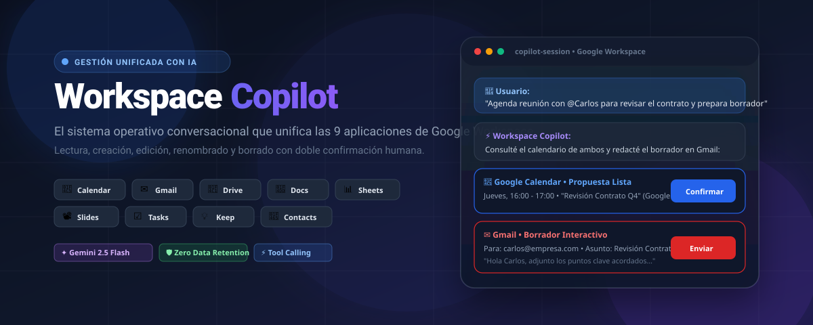
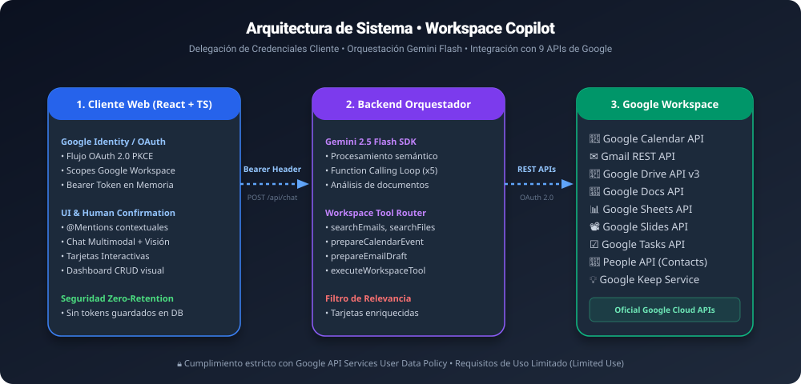

# Workspace Copilot ⚡
### *Gestión Unificada con IA para Google Workspace*

<div align="center">



[](https://react.dev/)
[](https://www.typescriptlang.org/)
[](https://tailwindcss.com/)
[](https://ai.google.dev/)
[](https://developers.google.com/workspace)
[](#-seguridad-y-cumplimiento-con-google-api-services)
[](./public/terms.html)

[Explorar Características](#-características-principales) • [Arquitectura](#-arquitectura-del-sistema) • [Modelo Comercial](#-modelo-comercial-freemium--plan-pro) • [Instalación](#-instalación-y-despliegue-local) • [Guía de Auditoría Google](#-guía-de-auditoría-y-verificación-google-oauth)

</div>

---

## 🌟 Visión del Producto y Propuesta de Valor

**Workspace Copilot** es una plataforma de productividad empresarial diseñada para transformar radicalmente la forma en que profesionales, empresas y creadores interactúan con el ecosistema de Google. 

Bajo la propuesta de valor **"Gestión Unificada con IA"**, el sistema consolida las 9 herramientas neurálgicas de Google Workspace en una sola consola inteligente:

> **Un único asistente conversacional con visión multimodal, capaz no solo de consultar y resumir, sino de gestionar el ciclo de vida completo (Crear, Leer, Editar, Renombrar y Eliminar) con tarjetas interactivas de confirmación humana.**

---

## 🚀 Las 9 Aplicaciones Integradas

| Aplicación | Icono | Capacidades de Gestión con IA (CRUD) |
| :--- | :---: | :--- |
| **Google Calendar** | 📅 | Consulta de agendas en múltiples calendarios (`Personal`, `Cursos`, etc.), detección de conflictos, creación con Google Meet, reprogramación y agendamiento masivo de clases en lote. |
| **Gmail** | ✉️ | Búsqueda semántica de hilos, resumen de correos no leídos, extracción de tareas y generación de borradores interactivos editables antes del envío. |
| **Google Drive** | 📁 | Exploración de carpetas, búsqueda de documentos por palabra clave, creación de carpetas, renombrado de archivos y envío a la papelera con 1 clic. |
| **Google Docs** | 📝 | Creación de documentos nuevos a partir de solicitudes, inserción y formateo de texto, resúmenes ejecutivos y análisis de contratos o minutas. |
| **Google Sheets** | 📊 | Creación de hojas de cálculo, generación de tablas estructuradas, consulta de métricas y preparación de informes de balance o inventario. |
| **Google Slides** | 📽️ | Creación de presentaciones corporativas, estructuras temáticas de diapositivas y esquemas de conferencias. |
| **Google Tasks** | ☑️ | Creación, lectura, actualización de estados (pendiente / completada) y eliminación de tareas vinculadas a correos y reuniones. |
| **Google Contacts** | 👥 | Búsqueda de libreta de direcciones (People API), visualización de teléfonos/correos de colegas y creación/edición de nuevos contactos. |
| **Google Keep** | 💡 | Panel de notas rápidas y listas de verificación sincronizadas, búsqueda por etiquetas e inserción directa en el contexto del chat. |

---

## 💎 Características Principales

### 1. Doble Confirmación de Acciones (Human-in-the-Loop)
La IA **nunca** ejecuta acciones destructivas o cambios en segundo plano de manera silenciosa.
* Si solicitas enviar un correo, Gemini prepara una **Tarjeta Interactiva de Borrador de Gmail** para que revises destinatarios, asunto y cuerpo antes de presionar *Enviar*.
* Si pides programar un curso de 16 semanas, el sistema muestra la **Tarjeta de Lote de Calendario** con todas las fechas calculadas y el botón de *Confirmar todo en 1 clic*.
* Si solicitas renombrar o eliminar un archivo, se despliega una **Tarjeta de Acción de Google Drive** con aviso de advertencia reversible.

### 2. Sistema de Autocompletado Inteligente con `@Menciones`
Escribe `@` en la caja de texto para desplegar el selector de recursos en tiempo real:
* `@Archivo` para buscar directamente entre tus documentos de Google Drive.
* `@Email` para referenciar un correo reciente o cadena de mensajes de Gmail.
* `@Evento` para citar una reunión de Google Calendar.
* `@Contacto` para obtener los datos de un compañero de equipo.
* `@Tarea` para asociar pendientes de Google Tasks.

### 3. Visión Multimodal y Análisis de Documentos
Arrastra o adjunta imágenes (`PNG`, `JPG`), facturas, diagramas o documentos (`PDF`, `DOCX`, `XLSX`, `CSV`).
* Gemini 2.5 Flash extrae tablas, detecta texto mediante OCR, interpreta recibos y ofrece transformaciones directas a Google Sheets o Calendar.

### 4. Dashboard Visual de Productividad
Además del chat conversacional, incluye una vista tipo **Dashboard unificado** con métricas clave, acceso rápido a Drive, listado de eventos de hoy, pendientes de Tasks y bloc de notas de Keep.

---

## 🏛️ Arquitectura del Sistema



### Principios Arquitectónicos
1. **Zero Data Retention (Sin retención de datos externos):** No almacenamos copias de tus correos, archivos, eventos o tareas en servidores externos permanentes. Las consultas se ejecutan en tiempo real bajo demanda directamente contra las APIs oficiales de Google.
2. **Delegación de Token de Cliente (Client-Side Bearer Delegation):** El token de acceso emitido por Google OAuth reside en memoria segura en el cliente (SPA) y se envía vía encabezado `Authorization: Bearer <token>` para cada llamada al backend orquestador.
3. **Gemini Tool Calling Loop:** El backend utiliza el SDK oficial `@google/genai` con bucle de hasta 5 iteraciones de llamada a herramientas para resolver consultas complejas de múltiples pasos (ej: *buscar correo -> extraer fecha -> verificar calendario -> preparar reunión*).

---

## 💼 Modelo Comercial: Freemium & Plan Pro

El producto está diseñado para monetización directa SaaS:

```
┌──────────────────────────────────────┐       ┌──────────────────────────────────────┐
│        PLAN FREEMIUM (Gratis)        │       │        PLAN PRO (Suscripción)        │
├──────────────────────────────────────┤       ├──────────────────────────────────────┤
│ • Acceso individual básico           │       │ • Consultas y respuestas ilimitadas  │
│ • Hasta 50 consultas mensuales IA    │       │ • Modelos de máxima velocidad Flash  │
│ • Búsqueda en los 9 servicios        │       │ • Análisis de archivos pesados (OCR) │
│ • Tarjetas interactivas de acción    │       │ • Agendamiento masivo de eventos     │
│ • Soporte de la comunidad            │       │ • Exportación avanzada y automatismo │
│                                      │       │ • Soporte prioritario por email      │
│                $0 / mes              │       │          $14.99 / mes ($149 / año)   │
└──────────────────────────────────────┘       └──────────────────────────────────────┘
```

---

## 🔒 Seguridad y Cumplimiento con Google API Services

Workspace Copilot ha sido diseñado desde el primer día para superar con éxito la **auditoría de Google Cloud para Scopes Sensibles y Restringidos**:

* **Declaración de Uso Limitado (Limited Use Disclosure):** El uso y la transferencia a cualquier otra aplicación de la información recibida a través de las APIs de Google se apegan estrictamente a la [Google API Services User Data Policy](https://developers.google.com/terms/api-services-user-data-policy).
* **Sin Entrenamiento de Modelos:** Los datos del usuario **NUNCA** se utilizan para entrenar, reentrenar o ajustar modelos fundacionales de inteligencia artificial de terceros.
* **Cifrado de Extremo a Extremo:** Comunicaciones protegidas bajo protocolo **TLS 1.3 / HTTPS de 256 bits**.
* **Páginas Públicas Legales Permanentes:**
  - Política de Privacidad: [`/public/privacy.html`](./public/privacy.html)
  - Términos y Condiciones: [`/public/terms.html`](./public/terms.html)
* **Revocación Inmediata:** Los usuarios pueden revocar el acceso en cualquier segundo desde [myaccount.google.com/permissions](https://myaccount.google.com/permissions).

---

## 🛠️ Stack Tecnológico

| Capa | Tecnologías |
| :--- | :--- |
| **Frontend** | React 19, TypeScript, Tailwind CSS v4, Lucide React, Canvas Confetti |
| **Backend** | Node.js, Express, TSX, dotenv |
| **Inteligencia Artificial** | Google Gen AI SDK (`@google/genai`), Gemini 2.5 Flash con Function Calling |
| **Autenticación** | Firebase Auth + Google Identity Services (OAuth 2.0 PKCE) |
| **APIs de Google** | Google Calendar API v3, Gmail REST API v1, Google Drive API v3, Google Docs API v1, Google Sheets API v4, Google Slides API v1, Google Tasks API v1, People API v1, Google Keep |
| **Build Tooling** | Vite 6, PostCSS, ESLint |

---

## 📦 Estructura del Proyecto

```
workspace-copilot/
├── public/
│   ├── banner.svg            # Hero banner oficial del repositorio
│   ├── architecture.svg      # Diagrama de arquitectura del sistema
│   ├── privacy.html          # Política de Privacidad pública (Google Limited Use)
│   └── terms.html            # Términos del Servicio públicos (Freemium & Pro)
├── src/
│   ├── components/
│   │   ├── ChatView.tsx              # Consola de chat, @menciones y renderizado de tarjetas
│   │   ├── WorkspaceCards.tsx        # Tarjetas interactivas (Gmail, Calendar, Drive, etc.)
│   │   ├── WorkspaceDashboard.tsx    # Dashboard visual de las 9 herramientas
│   │   ├── KeepNotesView.tsx         # Vista integrada de notas y checklists
│   │   ├── MentionDropdown.tsx       # Menú flotante de búsqueda rápida con @
│   │   ├── SignInScreen.tsx          # Landing page de autenticación y características
│   │   ├── Header.tsx                # Barra de navegación, estado de cuenta y logout
│   │   └── LegalModal.tsx            # Modal embebido de Términos y Privacidad
│   ├── server/
│   │   ├── api.ts                    # Endpoints Express (/api/chat, /api/health)
│   │   └── gemini.ts                 # Orquestador Gemini 2.5 Flash y enrutador de herramientas
│   ├── services/
│   │   └── auth.ts                   # Servicio Firebase Google Auth con Scopes ampliados
│   ├── types/
│   │   └── workspace.ts              # Tipos TypeScript para todas las APIs de Google y tarjetas
│   ├── App.tsx                       # Componente raíz con control de estado y sesiones
│   ├── main.tsx                      # Punto de entrada Vite React
│   └── index.css                     # Configuración de estilos globales con Tailwind CSS
├── server.ts                         # Servidor Express de desarrollo y producción
├── vite.config.ts                    # Configuración de Vite con middleware de API
├── package.json                      # Dependencias del proyecto
└── metadata.json                     # Metadatos del applet en Google AI Studio
```

---

## 💻 Instalación y Despliegue Local

### 1. Clonar el repositorio
```bash
git clone https://github.com/rodrigopazTech/Workspace-Copilot.git
cd Workspace-Copilot
```

### 2. Instalar dependencias
```bash
npm install
```

### 3. Configurar variables de entorno
Crea un archivo `.env` basado en `.env.example`:
```env
# Clave API de Google Gemini (Google AI Studio)
GEMINI_API_KEY=tu_gemini_api_key_aqui

# Puerto del servidor local
PORT=3000
```

### 4. Configurar Firebase & Google OAuth
1. Ve a [Firebase Console](https://console.firebase.google.com/) y crea o selecciona tu proyecto.
2. Activa **Authentication** con el proveedor **Google**.
3. En la pestaña de configuración web, copia los valores en `firebase-applet-config.json` o actualiza `src/services/auth.ts`:
   ```json
   {
     "apiKey": "AIzaSy...",
     "authDomain": "tu-proyecto.firebaseapp.com",
     "projectId": "tu-proyecto",
     "appId": "1:..."
   }
   ```
4. Agrega los orígenes autorizados de JavaScript y URIs de redirección:
   - `http://localhost:3000`
   - `http://localhost:5173`
   - Tu dominio de producción personalizado (ej. `https://tu-dominio.com`)

### 5. Iniciar en modo desarrollo
```bash
npm run dev
```
Abre tu navegador en `http://localhost:3000`.

### 6. Compilar para producción
```bash
npm run build
npm run start
```

---

## 📋 Guía de Auditoría y Verificación Google OAuth

Para obtener la verificación oficial de Google para scopes restringidos (`gmail.modify`, `drive`, etc.):

### 1. Requisitos Previos en Google Cloud Console
1. Ingresa a **APIs & Services > OAuth consent screen** en [Google Cloud Console](https://console.cloud.google.com/).
2. Configura el **User Type** como **External**.
3. Completa la información de la aplicación:
   - **App name:** `Workspace Copilot`
   - **User support email:** `contactorodrigopaz@gmail.com`
   - **Application home page:** `https://tu-dominio.com` (o la URL de tu app)
   - **Application privacy policy link:** `https://tu-dominio.com/privacy.html`
   - **Application terms of service link:** `https://tu-dominio.com/terms.html`
   - **Developer contact information:** `contactorodrigopaz@gmail.com`

### 2. Scopes Solicitados
Agrega los siguientes scopes necesarios para la gestión unificada:
* `https://www.googleapis.com/auth/calendar`
* `https://www.googleapis.com/auth/gmail.modify`
* `https://www.googleapis.com/auth/drive`
* `https://www.googleapis.com/auth/documents`
* `https://www.googleapis.com/auth/spreadsheets`
* `https://www.googleapis.com/auth/presentations`
* `https://www.googleapis.com/auth/tasks`
* `https://www.googleapis.com/auth/contacts`
* `openid`, `profile`, `email`

### 3. Grabación de Video de Demostración (Requerido por Google)
Google solicita un video en YouTube (puede ser oculto/unlisted) demostrando:
1. El inicio de sesión con Google donde se vea claramente el **Client ID** en la barra de URL.
2. La concesión de permisos.
3. El uso justificado de cada scope (ejemplo: mostrar cómo el usuario solicita enviar un correo, cómo la app muestra la tarjeta de borrador y cómo solo se envía tras la confirmación).

---

## 🗺️ Roadmap de Producción y Multi-Tenant

- [x] Unificación de 9 servicios de Google Workspace.
- [x] Tarjetas de acción interactivas con aprobación de 1 clic.
- [x] Menú @menciones contextuales.
- [x] Visión multimodal y OCR de documentos.
- [x] Páginas públicas de Privacidad y Términos listas para auditoría.
- [ ] **Fase 2:** Integración de pasarela de pagos con Stripe para suscripción Plan Pro.
- [ ] **Fase 3:** Arquitectura Multi-Tenant con organizaciones, asignación de asientos corporativos y roles (Admin / Miembro).
- [ ] **Fase 4:** Conexión con base de datos PostgreSQL en la nube para auditoría de acciones de equipo.

---

## 👨‍💻 Autor y Contacto

* **Líder de Proyecto:** Rodrigo Cristóbal Paz Jiménez
* **Correo de Contacto:** [contactorodrigopaz@gmail.com](mailto:contactorodrigopaz@gmail.com)
* **Propuesta de Valor:** Gestión Unificada con IA

---

<div align="center">
  <sub>Construido con pasión para potenciar la productividad en Google Workspace.</sub>
</div>
